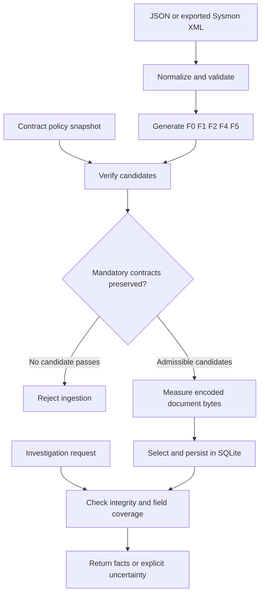

# SCOPE Complete Project Guide

**Security-Contracted Observability and Preservation**

SCOPE keeps useful computer records, saves space and explains which questions the saved information can answer. This guide uses the same names as the screens. Start with the walkthrough below. The later reference explains every file, command and stored field for readers who want the full details.

## Find your way around

- [Start SCOPE](#start-scope)
- [Your first example](#your-first-example)
- [What every screen does](#what-every-screen-does)
- [What every setting means](#what-every-setting-means)
- [How to read an answer](#how-to-read-an-answer)
- [Common problems](#common-problems)
- [What the project does behind the screens](#what-the-project-does-behind-the-screens)
- [Every project part](#every-project-part)
- [Simple typed commands](#simple-typed-commands)
- [What has been checked](#what-has-been-checked)
- [Full technical reference](#detailed-working-reference)

## Start SCOPE

1. Extract `SCOPE.zip`.
2. Open its `scope` folder.
3. On Windows, double-click `START_WINDOWS.bat`. On Parrot/Linux, open a terminal in the folder and run `sh start.sh`.
4. Open **http://127.0.0.1:8765** in a browser.
5. Keep the terminal open while using SCOPE. Press Ctrl+C in that terminal when finished.

Python 3.10 or later must already be installed. The delivered checks used Python 3.12. The basic program needs no API key, account, database server or extra package. The Windows launcher needs the Python `py` command; if it is unavailable, try `python app.py start` from the project folder.

The equivalent manual commands are:

Windows:

```powershell
py -3 app.py start
```

Parrot/Linux:

```sh
python3 app.py start
```

The local address refers to the same computer running the program. SCOPE is intended for use on that computer. To start a separate practice database or use a different port:

```sh
python app.py --db practice.db start --port 8877
```

Then open `http://127.0.0.1:8877`. In the remaining commands, replace `python` with `py -3` or `python3` when needed. Put `--db` and `--policy` before the command name.

## Your first example

1. From the homepage, click **Open SCOPE** to reach **Overview**.
2. Click **Try a guided example**.
3. SCOPE adds 24 made-up records, removes extra messages, keeps the usual required details and opens **Ask questions** for that group.
4. Read **Answer available** and the result table. The example asks for records belonging to program reference `proc-guid-2`. It shows the saved user, session and action details, plus record/source information and the selected filter.
5. Click **Ask about a removed message**.
6. Read **Not enough information**. The extra message was removed, so SCOPE cannot check whether it equals the supplied text. It does not invent a zero-match answer.
7. Open **Saved records**, choose **Open**, and read the explanation of what was kept. Use **Download saved information** to obtain the complete retained JSON.
8. Open **Results** to see the new batch. Select **Benchmarks** to see recorded synthetic comparisons.

Use the default rule file for this walkthrough. A custom rule file may require fields that the built-in examples do not contain. If so, use a compatible input file or return to the default rules. Every click on the guided example adds a new group; it does not erase earlier work.

The guided example restricts the storage choices to F1/F2 so the removed-message lesson is repeatable. Normal imports try all supported storage choices. A normal import can choose full records if that is the smallest suitable option after packing.

## What every screen does

| Screen | What you can do | What to read or click |
| --- | --- | --- |
| **Home** | Read the project introduction | Combined measured sizes across saved batches and **Open SCOPE** |
| **Overview** | Inspect local storage and try a guided example | Saved-group count, storage totals, and questions asked |
| **Add records** | Choose details to keep and add a made-up example or a file | Rule checkboxes, Windows shortcuts, example choice, file picker and the explanation of what was saved |
| **Saved records** | Browse groups that have already been added | Open a group, read its saved details, ask about it or download it |
| **Ask questions** | Find record details, follow program links or compare times | Choose a saved group, a question and any search conditions; read the answer table |
| **Results** | Read the supplied size and answer-quality comparisons | Full-record size versus SCOPE size under the same packing method |

A **record** is one entry about computer activity. A **group** is one set of records added together. Each group has a number. Questions work with one saved group at a time.

### Workspace overview

**Try a guided example** runs the prepared lesson above. The **Database breakdown** panel distinguishes original input, saved records and reading details, storage-choice notes, search notes, and the full database allocation. Those totals measure different things and should not be treated as the same file size.

### Add records

First select the details that each record must keep. Then choose an example and click **Add example records**, or select a supported file and click **Add selected file**.

After the import, **What was saved?** shows the group number, record count, computer/source, storage method, saved size and rules fully kept. **More details about the storage decision** shows structured storage and coverage information.

All required details must exist in every record in the submitted group. If they do not, SCOPE rejects the group and explains the missing information. For mixed Windows record types, it can help to split the file by type before importing.

### Saved records

Each row shows a group number, storage method, record count, saved size and details kept. Click **Open** to read its summary. Then choose **Ask about this group** or **Download saved information**.

**Delete** removes the batch and its investigation history after confirmation. Any exported files or backups are separate.

**Show older groups** moves through the list in groups of 50. **Back to newest groups** returns to the newest page. In **Ask questions**, **Open an older group by number** lets you open a known number directly. An opened group remains selected after refresh even if it is outside the latest list page.

If a stored group cannot be read, the list explains that failure instead of offering it as a normal readable group. Missing optional packing support is a possible cause; it does not automatically mean the stored bytes were damaged.

### Ask questions

Choose a group, then one of three questions:

| Question | What to enter | What it answers |
| --- | --- | --- |
| **Find details in the saved records** | Details to show; optionally one condition | Returns the supported recorded fields for matching records |
| **Which program started this program?** | Computer/source and program reference | Follows recorded links back through programs that started other programs |
| **Which record came first?** | Computer/source and two record numbers | Compares their recorded times |

For a simple search, **Find records where** offers User, Program reference, Record number, Session, Action, Remote address, Extra message and Computer/source. Enter the exact value under **Equals**. Capital letters matter. Choose **Show all records** to apply no condition.

You do not need to type JSON for an ordinary search. **Use more than one condition** is optional: open it, tick **Use the conditions below**, then enter a JSON object. Each condition needs a field name and a text value. All conditions must match. For example:

```json
{"source_id":"lab-win01","process_id":"proc-guid-2"}
```

Turn that checkbox off to return to the simple search. Merely leaving old text in the advanced box does not override the simple controls.

**Find answer** runs the current question. Results are shown as a readable table. **Show next results** loads the next page when one exists. **Search answer records** matches displayed field values case-insensitively across every page of a record answer. **Clear** restores the original answer. Changing a question clears its previous answer and continuation. If a question changes while a search is running, its old answer is not displayed as the answer to the new question.

The screen uses the rules saved with the selected group, including older custom rules. It does not silently replace them with today's import rules. **More details about this answer** keeps the exact API output for advanced use.

### Results

**Live results** charts measured document bytes for the selected batch, starting with the newest. The batch selector covers the latest 50 saved batches. The full and retained documents use the same codec. The retention table shows the measured size and eligibility of each candidate. SQLite allocation is tracked separately.

**Benchmarks** reads the packaged synthetic runs and displays document sizes, evidence checks, and median ingest and query timings. Select a workload and codec to change the chart. **Benchmark methodology** lists the measurement conditions and limits.

## What every setting means

### Details to keep

A rule says which details must survive together. The main screen uses these names:

| Screen name | What it keeps | Stable rule ID used in files/commands |
| --- | --- | --- |
| User, session and action | Recorded identity, session and action | EC-01 |
| Programs and the programs that started them | Process and immediate parent references | EC-02 |
| Before-and-after permission details | Explicitly supplied permission values, process and time | EC-03 |
| Programs, remote addresses and connection times | Recorded program/address/direction/time | EC-04 |
| Record numbers and times | Event identity and recorded time | EC-05 |

The long names explain the feature. The IDs stay unchanged so existing files, scripts and saved groups continue to work. Custom rules keep their own names. If a custom rule changes the fields associated with a usual ID, SCOPE shows its custom name instead of giving it an incorrect default description.

**Keep all listed details** selects all loaded rules. **Windows program records** selects EC-01, EC-02 and EC-05. **Windows connection records** selects EC-04 and EC-05. These shortcuts work only when those rules are present. With a custom rule file, select the available rules manually if a shortcut does not apply.

Under **More settings**, **Remove all required rules** permits SCOPE to remove all record content. Group information and storage notes may still remain. This is useful for a controlled demonstration, but it changes which questions can be answered.

Turning off a rule removes its guarantee. It does not require those fields to be deleted. Some optional details may still survive and support a later question.

### Example choice

| Choice | What it demonstrates |
| --- | --- |
| Repeated activity | Similar records can share repeated details |
| Mixed activity | Different values can make full per-record storage more suitable |
| Long extra messages | Removing unrequired messages can save substantial space |
| Program family | Recorded links between four programs, with a declared starting boundary |

Normal examples contain 600 records; the program-family example contains four. The guided Overview example contains 24. None is a real captured attack.

### Packing

**Plain text** uses uncompressed JSON. **Pack to save space** uses built-in zlib. **Extra packing** uses optional zstd and needs `requirements-benchmark.txt` installed. Packing saves space while preserving the content chosen by the storage method.

If you have not installed optional packages, leave **Plain text** or choose the built-in packing option. Reading an existing zstd group also requires its optional package.

### Storage method names

| Screen name | Meaning | Code in detailed output |
| --- | --- | --- |
| Full checked records | Keeps all supplied details after common-format checks | F0 |
| Required details only | Keeps base fields and fields named in the loaded rules, including optional rules | F1 |
| Repeated details stored together | Shares repeated retained values while preserving each record's identity and time | F2 |
| Checking value only | Keeps a whole-group checking value and count; not readable record facts | F4 |
| No record content | Removes event payload; keeps group/rule/storage information | F5 |

F3 is reserved for future work. F4 and F5 cannot satisfy normal mandatory record-detail rules. No storage method can override a selected rule simply because it is smaller.

## How to read an answer

| Screen message | Meaning | Code in advanced output |
| --- | --- | --- |
| Answer available | The retained details support this operation | SUPPORTED |
| No matches in this group | The question is supported but finds no matching retained record | SUPPORTED with zero matches |
| Not enough information | A needed detail, link, time or readable record is missing | INDETERMINATE |
| This question is not available | This operation is outside what this group/build supports | UNSUPPORTED |

“No matches” is limited to the selected group. It does not prove that the activity never happened elsewhere. “Not enough information” means that a relevant check cannot be completed; it is not a zero-result search.

Program history may be partial. A missing earlier program, conflicting parent or loop makes the history incomplete. `ROOT` is a declared boundary in the sample, not proof that every earlier computer activity was collected. Time comparisons use recorded times only. Equal times do not prove an order.

## Common problems

| What you see | What it means | What to do |
| --- | --- | --- |
| Cannot reach SCOPE | The local program may be stopped | Keep the terminal running and open the address it prints |
| No saved records yet | This database has no imported groups | Try the guided example or add a file |
| A needed detail is missing | Your selected rule requires a field absent from some input records | Inspect the file; select suitable rules or split record types. Do not invent values |
| Cannot read a zstd group | The optional packing package may be missing | Install `requirements-benchmark.txt` in the Python environment running SCOPE |
| Not enough information after searching Extra message | The extra message may have been removed | Choose a supported question; add the original file with F0 allowed/forced if full detail is required |
| No matches | Supported fields were checked, but exact values did not match | Check spelling, capitals, group and source |
| Group not found | That number is not in the current database | Check the database filename and saved-group list |
| Address is already in use | Another process uses the selected port | Stop the earlier SCOPE instance or start with `--port 8877` |
| Incompatible database rejected | Its storage format is different | Preserve it and replay source files into a new database |

## What the project does behind the screens

1. Read one nonempty group of records.
2. Check its basic details and put times into a common format.
3. Build the supported storage choices.
4. Compare required values with the checked original, keeping each value attached to the correct record and preserving occurrence counts.
5. Measure the full size of each allowed passing choice using one packing method.
6. Save the smallest suitable choice, its rules, field coverage and decision notes.
7. For a question, check readable stored information and needed fields before returning facts.

This preserves facts relative to the supplied input. It does not prove that the input is true, install a continuous monitoring agent, detect every attack or combine history across several saved groups. The before/after-permission rule preserves supplied values; it does not independently detect an increase in privilege. Connection records show a recorded association, not proof that an address caused an action.

## Every project part

| File or folder | Simple purpose |
| --- | --- |
| START_WINDOWS.bat / start.sh | Start the program from the extracted folder |
| app.py | Starts the service and handles typed commands and browser requests |
| dashboard.html | Defines the screen content, labels and layout |
| dashboard.js | Handles the guided example, friendly names, search forms and answer tables |
| engine.py | Checks records and rules, chooses storage, saves groups and answers questions |
| contracts.json | Defines rule names and fields |
| import_sysmon.py | Converts supported Windows XML records into the common record format |
| demo.py | Builds repeatable made-up examples |
| benchmark.py | Runs the defined size and correctness comparisons |
| examples/ | Provides JSON, XML, filter and custom-rule samples |
| tests/ | Holds Python regression checks and simulated screen-state checks |
| scripts/export_sysmon.ps1 | Exports bounded Windows Sysmon program/connection records for later validation |
| scripts/verify_package.py | Checks included file bytes against the shipped file list |
| docs/SCOPE_Project_Guide.md | This complete guide, also accessible from the running app |
| data/ | Packaged measurements and example outputs |

The default database file is created in the current working folder and keeps work after the program closes. Compatible existing stored documents remain readable.

## Simple typed commands

The friendly names below are aliases for the original commands. Both forms remain supported and return the same structured output. The browser offers a simpler way to read ordinary results.

| Friendly command | Original name | Purpose |
| --- | --- | --- |
| start | serve | Open the browser service |
| add-example | demo | Add made-up records |
| add-file | ingest | Add a SCOPE JSON file |
| add-windows | import-sysmon | Add supported Sysmon XML |
| ask | query | Ask for recorded details |
| program-history | ancestry | Follow recorded program-parent links |
| compare-times | order | Compare two recorded times |
| saved | list | List saved groups |
| storage | stats | Show storage totals |
| check-original | verify-original | Compare a whole group with an F4 checking value |

A repeatable terminal example uses a fresh database:

```sh
python app.py --db lesson.db add-file examples/demo-events.json --levels F1,F2
python app.py --db lesson.db ask 1 EC-01 --limit 2
python app.py --db lesson.db ask 1 EC-01 --filters-file examples/query_discarded_payload.json
python app.py --db lesson.db saved
python app.py --db lesson.db storage
```

The first answer is supported. The extra-message filter is indeterminate because the lesson removes that field. Global `--db`/`--policy` options precede the command. Export and backup retain their simple names:

```sh
python app.py --db lesson.db export 1 saved-group-1.json
python app.py --db lesson.db backup lesson-backup.db
```

Choose unused output names. Export writes retained information only. Backup writes a consistent database copy. Neither restores removed content or deletes separate original files.

## What has been checked

The Python test run passed 50 checks, including the new command aliases and external dashboard script route. The screen-state simulation passed 17 checks, including simple/advanced filters, result tables, historical rules, incomplete program history, equal times, stale-answer prevention, older-group selection, custom-rule shortcuts and empty storage.

The screen simulation is a small DOM model, not a real browser. Visual layout, keyboard-only use and screen-reader behavior remain to be checked in a real browser. The Windows helper is included but real Windows capture/export/replay validation remains pending.

The current benchmark is stored in `data/benchmark.json` and CSV. The result counts and measured sizes are shown in the full reference below. These experiments use three deterministic made-up workloads, not a real deployment.

## Preparing a short demonstration

Say: “SCOPE saves space in computer activity records while checking that the details needed for selected questions are kept.” Click the guided example, show its readable answer, then ask about a removed message. Explain the difference between “No matches” and “Not enough information.” Finally, open Saved records and Results.

The teacher report keeps only the five requested headings. This guide covers the full system and the detailed reference that follows. Normal users can work through the screens without editing JSON; students extending the program can use the original field names and commands below.

---

# Detailed working reference

The following sections explain the stored formats, original command names, API and functions. Technical names are retained where they must match code. The ordinary screen names above remain the recommended way to learn and demonstrate the project.


## Contents

1. [The problem and the central idea](#1-the-problem-and-the-central-idea)
2. [A concrete example](#2-a-concrete-example)
3. [What is implemented](#3-what-is-implemented)
4. [Terminology](#4-terminology)
5. [Architecture and data flow](#5-architecture-and-data-flow)
6. [Requirements and setup](#6-requirements-and-setup)
7. [A complete first demonstration](#7-a-complete-first-demonstration)
8. [The normalized event schema](#8-the-normalized-event-schema)
9. [Evidence contracts and policy snapshots](#9-evidence-contracts-and-policy-snapshots)
10. [Representation levels](#10-representation-levels)
11. [How sufficiency verification works](#11-how-sufficiency-verification-works)
12. [How the optimizer selects a representation](#12-how-the-optimizer-selects-a-representation)
13. [Capability descriptors and field coverage](#13-capability-descriptors-and-field-coverage)
14. [Storage, integrity and audit behavior](#14-storage-integrity-and-audit-behavior)
15. [Investigation modes and result meanings](#15-investigation-modes-and-result-meanings)
16. [Dashboard walkthrough](#16-dashboard-walkthrough)
17. [Complete CLI reference](#17-complete-cli-reference)
18. [HTTP API reference](#18-http-api-reference)
19. [Windows Sysmon collection and import](#19-windows-sysmon-collection-and-import)
20. [Benchmarks and metric interpretation](#20-benchmarks-and-metric-interpretation)
21. [Testing and validation](#21-testing-and-validation)
22. [Every file and component](#22-every-file-and-component)
23. [Core function reference](#23-core-function-reference)
24. [Extending contracts and data sources](#24-extending-contracts-and-data-sources)
25. [Troubleshooting](#25-troubleshooting)
26. [Backup, export and package verification](#26-backup-export-and-package-verification)
27. [Limits, trust assumptions and failure modes](#27-limits-trust-assumptions-and-failure-modes)
28. [Submission plan and acceptance criteria](#28-submission-plan-and-acceptance-criteria)
29. [Viva preparation](#29-viva-preparation)
30. [References and evidence](#30-references-and-evidence)

## 1. The problem and the central idea

Security telemetry describes activity such as process creation, authentication, privilege context and network connections. Retaining every original detail can consume substantial storage. Removing detail can also remove the exact relationship an investigator later needs.

Consider a record that connects a user, a logon session and a process. A simple activity count might retain the fact that 500 events occurred while losing which session performed which action. A later investigation could then mistake the lack of retained evidence for proof that something never happened.

SCOPE makes the preservation requirement explicit before reduction. A **Security Evidence Contract**, abbreviated SEC, states which fields must remain available together. The engine generates alternative representations, verifies them against the selected contracts, and selects the cheapest admissible representation. It also stores a description of what survived.

At query time, SCOPE checks whether the requested evidence is available. If the question requires discarded information, the answer is **INDETERMINATE**. It does not reconstruct or guess deleted content.

The present engineering objective is:

> Minimize the encoded evidence document size among the generated candidates, while preserving every mandatory contract exactly relative to the supplied normalized segment.

This is a security evidence preservation prototype. It is not a SIEM, malware detector, autonomous incident responder or live endpoint agent. Its value is making evidence loss explicit and testable.

Lossless compression remains a strong alternative. SCOPE can apply zlib or zstd after structured reduction and measures its candidates using the selected codec. Whether reduction is worthwhile depends on the workload and the evidence that must remain available.

## 2. A concrete example

Suppose an input record contains:

```json
{
  "event_id": "18",
  "source_id": "lab-win01",
  "event_type": "synthetic_correlated_event",
  "timestamp": "2026-11-09T00:00:00.018000000Z",
  "principal": "LAB\\analyst",
  "session_id": "session-1",
  "action": "connect",
  "process_id": "proc-guid-2",
  "parent_id": "proc-guid-1",
  "remote_ip": "203.0.113.10",
  "direction": "outbound",
  "raw_payload": "A large diagnostic message"
}
```

If the selected contracts require identity, direct ancestry, network observations and event timestamps, the engine must preserve those fields. It may remove `raw_payload` because none of those contracts requires it.

Repeated identical security fields may be grouped while keeping each event ID and timestamp. An identity query can still return the recorded principal, session and action. A query filtering on the deleted diagnostic message must return INDETERMINATE.

Two distinctions matter:

- The engine proves that selected supplied values survived reduction. It does not independently prove the original event was truthful.
- The network record establishes an observed endpoint relationship. It does not establish that the endpoint caused the process to act.

The example uses reserved documentation addresses and synthetic identifiers. It is not a captured incident.

## 3. What is implemented

| Capability | Delivered behavior | Boundary |
| --- | --- | --- |
| JSON replay ingestion | Validates and normalizes bounded event arrays | No continuous streaming collector |
| Sysmon XML adapter | Maps exported Event IDs 1 and 3 | No binary EVTX or Security-log parser |
| Evidence contracts | Five default JSON definitions and custom policy loading | Field projection predicates, not a general rule language |
| Candidate generation | F0, F1, F2, F4 and F5 | F3 deferred |
| Sufficiency verifier | Event-bound projection multiset equality | Relative to normalized supplied data |
| Optimization | Smallest complete candidate document under the chosen codec | Storage objective only |
| Compression | None, built-in zlib, optional zstd | Same codec for all candidates in one decision |
| Persistence | SQLite blobs, policy snapshots, descriptors and decision audits | Local database, no distributed controller |
| Recorded-fact queries | Exact filters, total counts, pagination | One segment per query |
| Parent-chain queries | Follows recorded links, detects gaps, conflicts and cycles | An explicit ROOT marker is a submitted boundary |
| Timestamp comparison | BEFORE, AFTER or SAME_TIMESTAMP | Same source; no cross-host clock model |
| F4 verification | Compare a supplied whole segment with its commitment | No recovery or single-event membership proof |
| Export and backup | Evidence JSON and consistent SQLite backup | No automatic incompatible database migration |
| Dashboard | Five navigation views | Browser visual verification remains pending |
| Validation | Automated unit, HTTP and CLI checks; three-workload benchmark | Synthetic data only |

The project is complete enough to run and explain as a bounded local research prototype. Real Windows replay validation remains a required submission milestone.

## 4. Terminology

| Term | Meaning |
| --- | --- |
| Event | One supplied normalized record with an identity and timestamp |
| Segment | One nonempty array submitted in a single ingestion operation |
| Principal | Recorded user or security identity |
| Session ID | Recorded logon/session identifier; not a guessed correlation |
| Process ID | A stable process reference; the Sysmon adapter uses ProcessGuid |
| SEC / contract | Required fields that must survive together for every event in a segment |
| Mandatory contract | A selected constraint that cannot be sacrificed for a smaller representation |
| Fidelity | A representation level, F0 through F5 with F3 deferred |
| ECD | Evidence Capability Descriptor describing retained capability status |
| Projection | Selected field values bound to source and event identity |
| Multiset | A collection that preserves occurrence counts as well as values |
| Admissible | A candidate that is permitted and satisfies all mandatory contracts |
| Codec | A lossless serialization compression method applied to a candidate document |
| Commitment | A SHA-256 digest that can be compared with subsequently supplied content |
| Oracle | Independently written expected results used to check observed query answers |
| Audit summary | Query request, verdict, selected metadata and result hash, without full answer copies |

## 5. Architecture and data flow



The input adapter changes source syntax into the common schema. The normalizer validates identifiers and timestamps. The generator creates alternative payloads. The verifier compares each payload with the normalized original. The optimizer considers only allowed candidates that satisfy all mandatory contracts. SQLite persists the winner and the decision metadata.

An investigation reads only retained storage. It checks the encoded document checksum, uses the stored policy definition and checks coverage for every required query field. No deleted raw copy is retrieved from `demo.py`, an input file or a hidden table.

The original input files can remain in the user's directory for reproducibility and private evidence handling. That does not mean the query engine uses them. Discarding data from SCOPE does not delete the user's separate source files.

## 6. Requirements and setup

### Core application

- Python 3.10 or newer with the standard `sqlite3` module.
- A writable directory for the SQLite database.
- A browser to use the dashboard, or a terminal for the CLI.
- No application API keys, frontend build, external database or mandatory pip packages.

The delivered automated run used Python 3.12. The core does not depend on the environment used to author the PDF.

Extract the archive and open a terminal in its `scope` directory. On Windows:

```powershell
py -3 app.py serve
```

On Parrot or another system where Python is named `python3`:

```sh
python3 app.py serve
```

The remaining examples use `python`. Substitute `py -3` or `python3` as appropriate. All commands are individual commands; no shell-specific loop is required.

Open <http://127.0.0.1:8765>. The service binds to loopback. Keep the terminal open and use Ctrl+C to stop it. The default database file is created in the current working directory and reused on restart.

To use a different database and port:

```sh
python app.py --db experiment.db serve --port 8877
```

Global `--db` and `--policy` options precede the subcommand.

### Optional zstd baseline

```sh
python -m pip install -r requirements-benchmark.txt
```

This is required only for zstd storage and the zstd benchmark cases. Uncompressed and zlib modes work without it. Opening a database containing zstd documents requires the package even if no new data is being compressed.

## 7. A complete first demonstration

Use a fresh database filename if you want the segment IDs below to match exactly. Existing databases continue their own ID sequence.

### Step 1: Ingest a small replay

```sh
python app.py --db tutorial.db ingest examples/demo-events.json --levels F1,F2
```

The supplied file has 24 synthetic records. Restricting the allowed levels makes removal of the uncontracted payload deterministic for this lesson. Mandatory contracts still apply; restricting levels cannot override them.

The delivered run selected F2, kept 24 events and stored a 3,966-byte uncompressed evidence document. This excludes the separate candidate audit and SQLite allocation. Exact output is captured in `data/walkthrough-results.json`.

### Step 2: Retrieve identity facts

```sh
python app.py --db tutorial.db query 1 EC-01 --filters-file examples/query_identity.json --limit 2
```

The filter file contains `{"process_id":"proc-guid-2"}`. Expected result fields include:

```json
{
  "verdict": "SUPPORTED",
  "total_matches": 24,
  "returned": 2,
  "offset": 0,
  "next_offset": 2
}
```

The actual response also includes the requested recorded details, group ID, rule, scope and reason. The keys use the original field names described below. The example above is an excerpt, not the complete response.

### Step 3: Request discarded detail

```sh
python app.py --db tutorial.db query 1 EC-01 --filters-file examples/query_discarded_payload.json
```

Expected verdict: **INDETERMINATE**. `raw_payload` has no exact retained coverage. A zero-match answer would be unjustified because the filter cannot be evaluated against deleted content.

### Step 4: Demonstrate a parent chain

```sh
python app.py --db tutorial.db demo --scenario chain
python app.py --db tutorial.db ancestry 2 lab-win01 proc-3
```

The synthetic chain is `proc-3` to `proc-2` to `proc-1` to `proc-0` to `ROOT`. ROOT is an explicit boundary supplied by this fixture. The answer does not certify complete operating-system ancestry. Missing parents, cycles and conflicting parent values return INDETERMINATE with the partial chain.

### Step 5: Compare recorded timestamps

```sh
python app.py --db tutorial.db order 2 lab-win01 0 1
```

Expected relation: **BEFORE**. The relation concerns recorded timestamps. Equal timestamps produce SAME_TIMESTAMP, not an invented order based on event ID or input array position.

### Step 6: Permit payload discard

```sh
python app.py --db tutorial.db ingest examples/demo-events.json --contracts none --levels F5
python app.py --db tutorial.db query 3 EC-01
```

Expected verdict: **INDETERMINATE**. The segment metadata still records source/time scope and policy, but the event payload was discarded. F5 does not mean that every byte of audit metadata disappears.

### Step 7: Demonstrate a commitment

```sh
python app.py --db tutorial.db ingest examples/demo-events.json --contracts none --levels F4
python app.py --db tutorial.db verify-original 4 examples/demo-events.json
```

Expected result: SUPPORTED with `matches: true`. A changed supplied segment yields `matches: false`. This compares a digest of the entire normalized segment. It does not recover content or prove that the supplied events were authentic.

### Step 8: Inspect storage and export evidence

```sh
python app.py --db tutorial.db stats
python app.py --db tutorial.db export 1 retained-segment-1.json
python app.py --db tutorial.db backup tutorial-backup.db
```

Choose unused output names. Export and backup refuse to overwrite existing files.

## 8. The normalized event schema

The top-level ingestion body is a JSON array. Each event is an object. Base fields are mandatory even when no evidence contracts are selected.

| Field | Type | Required when | Meaning |
| --- | --- | --- | --- |
| event_id | Nonempty string | Always | Unique within a source in this segment |
| source_id | Nonempty string | Always | Origin/source identifier |
| event_type | Nonempty string | Always | Record category |
| timestamp | ISO date/time string with timezone | Always | Canonicalized to UTC with nine fractional digits |
| principal | Nonempty string | EC-01 | Recorded identity |
| session_id | Nonempty string | EC-01 | Recorded session |
| action | Nonempty string | EC-01 | Recorded action |
| process_id | Nonempty string | EC-02, EC-03, EC-04 | Stable process reference |
| parent_id | Nonempty string | EC-02 | Recorded immediate parent |
| privilege_before | Nonempty string | EC-03 | Explicit supplied prior context |
| privilege_after | Nonempty string | EC-03 | Explicit supplied subsequent context |
| remote_ip | Nonempty string | EC-04 | Observed remote endpoint value |
| direction | Nonempty string | EC-04 | Recorded connection direction |
| raw_payload | JSON value, normally a string | No default contract | Additional source detail, retained in F0 |

Contract fields present in a record must be nonempty strings. A field being structurally valid does not prove that its content is correct; for example, the engine does not independently validate a claimed privilege transition.

Unknown JSON fields are permitted and remain available to F0. F1/F2 retain base fields and the union of fields in the active policy definitions. Thus an optional contract can still be EXACT when its fields survived incidentally. Disabling a contract removes its guarantee; it does not require its fields to be destroyed.

Normalization rejects:

- Empty arrays, more than 20,000 records or more than 16,000,000 canonical input bytes.
- Missing or incorrectly typed base fields.
- Duplicate `(source_id, event_id)` pairs inside a segment.
- NaN and Infinity JSON values.
- Timestamps without a timezone, malformed timestamps, or more than nine fractional digits.

An example time conversion is `2026-11-09T05:30:00.1234567+05:30` to `2026-11-09T00:00:00.123456700Z`. The final two zeroes express the same instant at the canonical precision; they do not add measurement accuracy.

Events are sorted by canonical timestamp, then source and event ID for deterministic encoding. The secondary keys do not establish true temporal precedence. Duplicate IDs across different segments are not checked. Log clearing or identity reuse therefore needs capture context in any future cross-segment correlation design.

F0 retains the full **normalized event object**, not the exact original file bytes or original JSON formatting.

## 9. Evidence contracts and policy snapshots

`contracts.json` contains a version string and a map of definitions. A definition has a readable name and a nonempty list of required field names.

```json
{
  "policy_version": "example-policy-1",
  "contracts": {
    "EC-01": {
      "name": "Identity attribution",
      "fields": ["principal", "session_id", "action"]
    }
  }
}
```

The loader validates the structure and field names. It does not execute Python expressions from the policy file. The generic verifier interprets the field lists as projection predicates.

| Contract | Fields | Current meaning |
| --- | --- | --- |
| EC-01 | principal, session_id, action | Recorded principal/session/action attribution |
| EC-02 | process_id, parent_id | Recorded immediate parent relationship |
| EC-03 | process_id, privilege_before, privilege_after, timestamp | Preservation of explicitly supplied transition fields |
| EC-04 | process_id, remote_ip, direction, timestamp | Preservation of an observed endpoint/process/time association |
| EC-05 | event_id, timestamp | Preservation of event timestamps and identities |

Every selected contract applies to every event in the submitted segment. There is no per-event applicability language in SCOPE. A segment containing process records and network records may therefore be rejected when fields are missing from some events. Separate supported record classes or choose a policy whose fields genuinely exist throughout the segment. Do not fill missing evidence with fabricated values to make ingestion pass.

The complete policy definitions and mandatory IDs are embedded in each stored document. Query evaluation uses that historical snapshot. Changing the current `contracts.json` cannot silently reinterpret a previous segment.

## 10. Representation levels

| Level | Stored payload | Query implications |
| --- | --- | --- |
| F0 | Full normalized event objects | All complete source fields can remain queryable |
| F1 | Base and defined contract fields | Uncontracted payload can be lost |
| F2 | Shared semantic field groups plus per-event IDs/timestamps | Reconstructs retained records without discarded detail |
| F3 | Not generated | Semantic summaries are future work |
| F4 | SHA-256 of the entire normalized segment and event count | Supports whole-segment comparison only |
| F5 | JSON null payload | No retained event facts; metadata remains |

F2 is an exact factoring of the retained structured records. It is not a lossy time bucket and does not remove individual event IDs or timestamps. Two records can share a group only when all retained fields other than `event_id` and `timestamp` are identical. The group therefore includes source identity.

The generator constructs all five implemented candidates before evaluating the allowed-level restriction. Restricting levels is useful for demonstrations and experiments, but does not reduce candidate-generation CPU or memory in this implementation.

With mandatory contracts, F4/F5 normally fail verification. With no mandatory contracts, F5 normally wins. To demonstrate F4 specifically, select `--contracts none --levels F4`. This is an explicit retention constraint, not evidence that the unconstrained optimizer prefers F4.

## 11. How sufficiency verification works

For a contract with required field set `F`, the verifier uses the sorted field set:

`{source_id, event_id} union F`

For each source event, it serializes the values of that field set. It builds a multiset of those serialized tuples. The same operation is performed on the candidate's expanded records.

A capability is EXACT only when:

1. Every required field exists in every source event.
2. The original and retained projection multisets are equal.

Binding each tuple to source and event identity matters. If Alice's attribution and Bob's attribution are swapped between events, the multiset of names alone is unchanged. The identity-bound projection changes and fails verification.

Occurrence counts matter too. If one F2 occurrence is dropped, the source and retained multisets differ even if every remaining value appears plausible.

Example:

```text
Source record 7: source=host-A, principal=Alice, session=S1, action=connect
Source record 8: source=host-A, principal=Bob,   session=S2, action=create
```

Changing record 7 to Bob/S2 and record 8 to Alice/S1 does not preserve EC-01. The verifier tests the values attached to each event, not just the set of possible users.

This is a deterministic check over finite submitted data. It is not a proof that the source was complete, that the required fields have correct real-world semantics, or that the verifier itself is immune to implementation defects.

## 12. How the optimizer selects a representation

For each candidate, the engine builds a complete evidence document containing its payload, representation label, policy snapshot, source/time summary, descriptors and field coverage. It serializes the document using the chosen codec and measures the resulting byte length.

A candidate is admissible only if:

- Its level appears in `allowed_levels`, if a restriction was supplied.
- Every mandatory contract has status EXACT.

The winner is the admissible candidate with the smallest encoded document. Ties use the fixed order F0, F1, F2, F4, F5.

Formally, for the generated candidate set `C`:

`R* = argmin encoded_bytes(codec(document(R)))`

subject to `R in C`, `R allowed`, and `EXACT(R, c)` for every mandatory contract `c`.

The candidate decision audit is stored separately. Every candidate's size and rejection information is retained, so its cost does not favor one winning representation over another. SQLite page allocation and query summaries are also outside this optimization objective and are reported separately.

This is the exact minimum over the generated admissible candidates for the chosen codec. It is not the minimum over all possible encodings, codecs, field subsets or database designs. The engine does not jointly optimize CPU, bandwidth, latency or future evidence utility.

zlib uses level 9. Optional zstd uses level 3. The same selected codec is used for all candidates within that ingestion decision.

## 13. Capability descriptors and field coverage

Each contract descriptor stores:

| Field | Meaning |
| --- | --- |
| status | EXACT, PARTIAL or UNAVAILABLE |
| required_fields | Fields defined by the stored contract |
| missing_source_fields | Fields absent from at least one source event |
| method | Verifier method/version description |
| reason | Human-readable explanation |

EXACT means the required projection passed. PARTIAL means retained records exist but the exact predicate did not pass. It is not a numerical percentage and must not be interpreted as “mostly proved.” UNAVAILABLE means the representation exposes no event facts.

A separate `field_coverage` map tracks whether each source field exists in every original event and survives with the same event-bound values. This prevents a query from using an unprotected filter field merely because some contract is EXACT.

For example, EC-01 can be EXACT while `raw_payload` is UNAVAILABLE. An identity query filtered on `process_id` can pass if that field has exact coverage. An identity query filtered on `raw_payload` cannot pass if it was removed.

Coverage is deliberately conservative at the segment level. A query can return INDETERMINATE when a field is missing from an event that would not ultimately match the filter. The current engine does not first infer a safe applicable subset and weaken the coverage requirement.

## 14. Storage, integrity and audit behavior

SQLite tracks the storage schema internally. If the format is incompatible, use a new database and import the original records.

### segments table

| Column | Storage type | Meaning |
| --- | --- | --- |
| id | INTEGER primary key | Local segment identifier |
| document | BLOB | Encoded complete evidence document |
| codec | TEXT | none, zlib or zstd |
| sha256 | TEXT | Digest of the encoded document blob |
| candidate_audit | TEXT | Canonical JSON candidate sizes and admissibility |
| input_bytes | INTEGER | Canonical input JSON size before normalization |
| created_at | TEXT | Ingestion time recorded by this application |

The document itself stores `schema_version`, `policy_version`, `contracts`, `mandatory`, `source_event_count`, `sources`, `time_start`, `time_end`, `level`, `payload`, `descriptor` and `field_coverage`.

The digest covers the encoded evidence document, including the policy snapshot and descriptors. It does not authenticate the separate candidate audit, ingestion timestamp or database file. A database writer can replace both the document and its checksum. Trusted signing or external immutable storage would be needed for stronger authenticity claims.

### investigations table

| Column | Storage type | Meaning |
| --- | --- | --- |
| id | INTEGER primary key | Local query audit identifier |
| segment_id | INTEGER | Referenced segment |
| created_at | TEXT | Query time |
| summary | TEXT | Request, verdict, reason, total matches where relevant, and result SHA-256 |

An index supports lookup by segment ID. No dedicated query-history UI is implemented.

The audit does not retain the full answer. A 1,000-record response therefore does not get copied back into storage as a second evidence archive. A hash identifies the particular returned result but cannot reconstruct it. Re-running the same page can reproduce it while retained evidence and policy remain unchanged.

`stats` distinguishes document bytes, candidate-audit bytes, query-summary bytes and SQLite allocated bytes. Database allocation includes page and index overhead; it must not be equated with the sum of compressed payload lengths.

## 15. Investigation modes and result meanings

### Recorded facts

Inputs are segment ID, contract ID, string-valued exact filters, limit and offset. The engine validates the document, loads its policy snapshot, requires the capability and every requested field to have exact coverage, and then evaluates filters.

All filters are combined with logical AND. Matching is case-sensitive string equality. There are no regex, contains, arbitrary SQL or natural-language operators. A timestamp filter must use the canonical stored string if it is to match exactly.

The result includes a total count and a page of facts. Limits are 1 to 1,000 and offsets are nonnegative integers. A non-null `next_offset` identifies the next page. Pagination order is deterministic but is not a causality claim.

### Parent chain

Inputs are segment ID, source ID and process ID. The engine requires exact source, event, process and parent fields, builds the recorded parent relationships for that source, and walks them.

- Reaching an explicit ROOT boundary after at least one recorded edge returns SUPPORTED for that submitted chain.
- An unobserved parent, a cycle or more than one parent value for a process returns INDETERMINATE with the partial chain.
- ROOT by itself is not an observed process and does not create a supported answer.

The adapter never inserts ROOT to repair missing ancestry. The special marker exists in the synthetic chain fixture and in user-supplied data that explicitly declares such a boundary.

### Recorded timestamp comparison

Inputs are segment ID, source ID and two event IDs. Both records must exist in that source segment. The engine compares canonical timestamp strings at their preserved precision.

BEFORE and AFTER describe recorded timestamps. SAME_TIMESTAMP explicitly indicates a tie. The engine does not compare different hosts or infer clock synchronization.

### Whole-segment commitment

F4 stores a digest of the canonical normalized event array. `verify-original` normalizes the supplied array using the historical contract definitions and compares its digest.

SUPPORTED with `matches: false` means the supplied whole normalized segment differs from the committed one. It does not mean that none of its events occurred. The operation is not a Merkle membership proof and cannot reconstruct the deleted original.

### Verdicts

| Verdict | Meaning | What it does not mean |
| --- | --- | --- |
| SUPPORTED | The implemented operation can be evaluated on sufficient retained facts | The source was truthful or collection complete |
| INDETERMINATE | Required data, integrity or relationship completion is unavailable | The suspected activity did not happen |
| UNSUPPORTED | The requested class or operation is not implemented for this context | A negative factual result |

A supported record query returning zero matches means no matching record in that submitted segment. It does not establish global absence.

## 16. Dashboard walkthrough

The [plain screen guide](#what-every-screen-does) describes every view and button. The workspace includes Overview, Add records, Saved records, Ask questions and Results.

The normal search uses a field and text value. More than one condition is optional and uses JSON only when explicitly enabled. Results are shown in a table; exact API output remains under More details. The guided example forces F1/F2 with 24 made-up records so the removed-message lesson is repeatable. Ordinary imports choose among all implemented storage forms.

Historical rule definitions come from the selected saved group. Question changes invalidate both old answers and continuation. A late answer from an earlier question is not displayed as the answer to a changed form. Directly opened older groups remain selected after refresh.

The Windows shortcuts require the standard rule IDs to exist. They do not silently remove custom rules if those IDs are missing. The full source retains IDs and field keys for compatibility, while the screen displays the names explained at the start of this guide.

## 17. Complete CLI reference

General syntax:

```text
python app.py [--db FILE] [--policy FILE] SUBCOMMAND [OPTIONS]
```

| Subcommand | Arguments and options | Operation |
| --- | --- | --- |
| serve | --port N, default 8765 | Start loopback dashboard/API |
| demo | --scenario repetitive/diverse/entropy/chain; --count N | Ingest generated fixture; chain always has 4 events |
| ingest | FILE | Ingest normalized JSON array |
| import-sysmon | FILE | Convert and ingest supported XML |
| query | SEGMENT CONTRACT; --filters JSON or --filters-file FILE; --limit N; --offset N | Retrieve projected facts |
| ancestry | SEGMENT SOURCE PROCESS | Traverse recorded parent links |
| order | SEGMENT SOURCE EVENT_A EVENT_B | Compare recorded timestamps |
| verify-original | SEGMENT FILE | Compare JSON with an F4 commitment |
| export | SEGMENT FILE | Write retained document and metadata |
| backup | FILE | Write consistent SQLite backup |
| list | --limit N; --offset N | List summaries, newest first |
| stats | No extra arguments | Show storage statistics |

`demo`, `ingest` and `import-sysmon` also accept:

| Option | Behavior |
| --- | --- |
| --contracts EC-01,EC-05 | Choose mandatory contracts |
| --contracts none | Explicitly allow no mandatory evidence contracts |
| --codec none/zlib/zstd | Choose one codec for selection and storage |
| --levels F1,F2 | Restrict admissible representation levels |

Omitting `--contracts` selects every definition in the loaded policy. Unsupported contract IDs fail rather than being ignored. Empty comma-separated items fail; use the explicit word `none` to select no contracts.

Useful examples:

```sh
python app.py --db process.db import-sysmon examples/sysmon-process-synthetic.xml --contracts EC-01,EC-02,EC-05
python app.py --db network.db import-sysmon examples/sysmon-network-synthetic.xml --contracts EC-04,EC-05 --codec zlib
python app.py --policy examples/contracts-dns.json --db dns.db ingest examples/dns-event.json --contracts EC-DNS,EC-05
python app.py --policy examples/contracts-dns.json --db dns.db query 1 EC-DNS
python app.py --db tutorial.db query 1 EC-05 --limit 10 --offset 10
```

Errors are written to stderr and return exit code 2. Successful commands return exit code 0. Use `python app.py --help` or a subcommand's `--help` for the installed parser's exact syntax.

The standalone converter is also available:

```sh
python import_sysmon.py exported-events.xml normalized-events.json
```

This writes converted JSON without inserting a database segment. Choose a new output filename when preserving earlier conversion evidence.

## 18. HTTP API reference

The service is local HTTP at `http://127.0.0.1:8765`. Request bodies must be JSON objects with `Content-Type: application/json`. Both loopback Host and same-origin checks are applied. There is no user authentication, TLS endpoint or public deployment configuration.

### Routes

| Method and route | Purpose |
| --- | --- |
| GET / | Dashboard HTML |
| GET /guide | Complete guide as local plain text |
| GET /dashboard.js | Browser behavior, friendly labels and result tables |
| GET /api/health | Status and application version |
| GET /api/state?limit=50&offset=0 | Active policy, storage totals and paged segment summaries |
| GET /api/segment/ID | Complete decoded retained segment |
| GET /api/export/ID | Same retained JSON as a download attachment |
| GET /api/benchmark | Recorded benchmark file |
| POST /api/demo | Generate and ingest synthetic fixture |
| POST /api/ingest | Ingest normalized JSON events |
| POST /api/import-sysmon | Convert and ingest XML string |
| POST /api/query | Record, ancestry or order investigation |
| POST /api/verify-original | Compare an F4 commitment with supplied events |

### Ingestion request

```json
{
  "events": [],
  "mandatory": ["EC-01", "EC-05"],
  "codec": "zlib",
  "allowed_levels": ["F0", "F1", "F2"]
}
```

The empty `events` above illustrates the key location only; replace it with a nonempty valid event array. `/api/demo` replaces `events` with optional `scenario` and `count`. `/api/import-sysmon` replaces it with an `xml` string. `mandatory` defaults to all contracts, `codec` to none and `allowed_levels` to all implemented levels.

### Recorded-fact query

```json
{
  "segment_id": 1,
  "mode": "records",
  "contract": "EC-01",
  "filters": {"process_id": "proc-guid-2"},
  "limit": 100,
  "offset": 0
}
```

### Parent-chain query

```json
{
  "segment_id": 2,
  "mode": "ancestry",
  "source_id": "lab-win01",
  "process_id": "proc-3"
}
```

### Timestamp query

```json
{
  "segment_id": 2,
  "mode": "order",
  "source_id": "lab-win01",
  "event_a": "0",
  "event_b": "1"
}
```

### Commitment request

Supply `segment_id` and `events` to `/api/verify-original`. The referenced segment must use F4. The events are required comparison material, not an automatic retrieval of deleted data.

### Response and error behavior

Record responses contain `verdict`, `reason`, `scope`, `segment_id`, `contract`, and, when supported, `answer`, `total_matches`, `returned`, `offset` and `next_offset`. Indeterminate field queries also identify missing fields where applicable.

| HTTP status | Meaning |
| --- | --- |
| 200 | Request processed, including domain verdicts INDETERMINATE or UNSUPPORTED |
| 400 | Invalid input, missing required field, rejected contract evidence or invalid stored-document request |
| 403 | Non-loopback Host or cross-origin request |
| 404 | Unknown GET route or missing GET segment/benchmark |
| 413 | Invalid/oversized HTTP body length, above 20,000,000 bytes |
| 415 | Wrong content type |
| 500 | Local storage or operating-system failure |

The normalizer's stricter 16,000,000-byte canonical segment limit still applies after HTTP transport. The XML adapter also limits its input string to 16 MB. Bodies are read with a 15-second socket timeout. The HTTP server is single-threaded and should remain a local demonstration service.

## 19. Windows Sysmon collection and import

Microsoft documents Sysmon process creation as Event ID 1 and network connections as Event ID 3. Process GUIDs help distinguish reused numeric PIDs, and network logging must be enabled in the collection configuration. The adapter preserves recorded fields; it does not install or configure Sysmon. [Microsoft Sysmon documentation](https://learn.microsoft.com/en-us/sysinternals/downloads/sysmon)

The package includes a Windows PowerShell export script. It has been inspected but not executed on a Windows host in this session. Use it as a lab-validation step, not as evidence of an already completed collection.

From the project directory in Windows PowerShell:

```powershell
.\scripts\export_sysmon.ps1 -Kind process -Hours 1 -MaxEvents 1000 -OutputFile .\process-capture.xml
.\scripts\export_sysmon.ps1 -Kind network -Hours 1 -MaxEvents 1000 -OutputFile .\network-capture.xml
```

The script uses `Get-WinEvent` to select recent records, writes a single `<Events>` XML document and creates a `.manifest.json` sidecar. The manifest records the machine, export time, selection limits, returned count, record IDs and file SHA-256. It refuses to overwrite either destination. It does not change Sysmon configuration. Some event-log reads require an elevated session. [Get-WinEvent documentation](https://learn.microsoft.com/en-us/powershell/module/microsoft.powershell.diagnostics/get-winevent)

Import the captures with contracts supported by their fields:

```sh
python app.py --db windows-process.db import-sysmon process-capture.xml --contracts EC-01,EC-02,EC-05
python app.py --db windows-network.db import-sysmon network-capture.xml --contracts EC-04,EC-05
```

If the input lacks a required LogonGuid or parent field, ingestion should fail. Inspect the actual export and choose an honestly supportable policy. Do not replace missing evidence with a constant session or fabricated parent.

### Adapter mapping

| XML value | Normalized field | Rule |
| --- | --- | --- |
| System/Computer | source_id | Copied |
| System/EventRecordID | event_id | Copied as string |
| System/TimeCreated/@SystemTime | timestamp | UTC canonicalization preserves up to 9 fractional digits |
| EventData/ProcessGuid | process_id | Copied when present |
| EventData/ParentProcessGuid | parent_id | Copied when present |
| EventData/User | principal | Copied when present |
| EventData/LogonGuid | session_id | Copied when present |
| Event ID 1 | event_type, action | sysmon_process_create, process_create |
| Event ID 3 | event_type, action | sysmon_network_connection, network_connection |
| Initiated=true | direction, remote_ip | outbound and DestinationIp |
| Initiated=false | direction, remote_ip | inbound and SourceIp |
| Serialized Event XML | raw_payload | ElementTree serialization, not exact original file bytes |

Unsupported providers/types, DTD/entity declarations and malformed XML are rejected. Missing Initiated or endpoint fields remain missing. The adapter does not infer privilege transitions from process integrity labels, assign external/internal status to an address, or infer causal influence.

### Real-lab acceptance procedure

1. Record Windows and Python versions, Sysmon configuration and the collection window.
2. Export process and network records separately. Preserve originals and manifests privately.
3. Manually select several source records and write expected principals, session references, GUIDs, endpoints and timestamps before querying SCOPE.
4. Import each supported segment and compare projected answers with those independent observations.
5. Test a missing-field case and a discarded-detail query.
6. Record exact commands, outputs, segment IDs and input hashes. Add this evidence to the report only after it has actually been collected.

A bounded export can omit earlier ancestors or stop at MaxEvents. A successful adapter import is not proof of complete collection.

## 20. Benchmarks and metric interpretation

Run:

```sh
python benchmark.py --events 300 --trials 3
```

This writes `data/benchmark.json` and `data/benchmark.csv`. Optional `--output FILE` changes the JSON destination and writes the CSV beside it. The benchmark accepts 1 to 1,000 events and 1 to 20 timing trials per case.

### Workloads

| Scenario | Construction | Question addressed |
| --- | --- | --- |
| repetitive | Repeated security fields and repeated diagnostic payload | How effective is factoring when records repeat? |
| diverse | More varied users, sessions, processes, actions and endpoints | Does the selected fidelity change with diversity? |
| entropy | Diverse security fields with seeded random diagnostic content | What is the effect of discarding expensive unprotected detail? |

Seed 173 makes the generated data reproducible. Each case records the canonical input hash. These are deliberately synthetic correlated records that carry all five contracts' fields, not raw heterogeneous Sysmon events.

### Comparisons

For each workload and available codec, the benchmark measures:

- Canonical raw input JSON bytes and codec-only raw bytes.
- A forced-F0 store using the same policy and codec.
- An optimized store using the generated candidate set.
- Document bytes, separate candidate audit, SQLite allocation before/after the same query workload, and query-summary bytes.
- Median/min/max ingestion wall time, median Python-process CPU time, median query latency and a separate traced-allocation run.

Timing trials run without tracemalloc. Python traced allocation is collected separately and is not process RSS. CPU measurements cover the local Python process, not a Windows endpoint agent. Network bandwidth and physical write I/O are not measured.

F0 and optimized stores answer the same 15 protected queries per case: five contract classes with an all-record query, a known-principal filter and an absent-principal filter. Expected outputs are constructed directly from the fixture and the written contract specification. The oracle does not call the production normalizer, expander or verifier. Ten additional checks require INDETERMINATE for deliberately removed fields or discarded records.

### Delivered measurements

<!-- BENCHMARK_TABLE -->

| Workload | Codec | Level | F0 bytes | SCOPE bytes | Saved |
| --- | --- | --- | --- | --- | --- |
| repetitive | none | F2 | 316,127 | 21,555 | 93.18% |
| repetitive | zlib | F2 | 3,744 | 2,409 | 35.66% |
| repetitive | zstd | F2 | 2,090 | 1,600 | 23.44% |
| diverse | none | F1 | 313,459 | 106,465 | 66.04% |
| diverse | zlib | F1 | 6,420 | 4,959 | 22.76% |
| diverse | zstd | F2 | 5,883 | 5,079 | 13.67% |
| entropy | none | F1 | 311,059 | 106,465 | 65.77% |
| entropy | zlib | F1 | 119,840 | 4,959 | 95.86% |
| entropy | zstd | F2 | 108,795 | 5,079 | 95.33% |

<!-- /BENCHMARK_TABLE -->

The measurements above are observations from this delivered run. Re-running on another system will change timing and can change encoded sizes with library revisions. The JSON records the actual environment.

### Metrics

| Metric | Formula or interpretation |
| --- | --- |
| Same-codec document savings | 1 - optimized document bytes / forced-F0 document bytes |
| Protected preservation rate | Correct protected query results / attempted protected queries |
| Observed false-answer rate | Incorrect determinate results / determinate results |
| Observed indeterminate correctness | Correct expected-indeterminate results / expected-indeterminate cases |
| Database growth | Allocated bytes after the query workload minus before it |

The delivered suite passed 135/135 protected queries and 10/10 expected-indeterminate cases, with 0 incorrect determinate results in those 135 observations. These are test-suite results, not guarantees about arbitrary future questions.

The entropy workload's large savings arise because the random payload is intentionally outside the mandatory contracts. That is an experimental construction, not an estimate of real enterprise savings. Raw codec-only sizes exclude metadata and must not be presented as directly equivalent to whole-database allocation.

## 21. Testing and validation

```sh
python -m unittest discover -s tests -v
```

The delivered run passes 51 automated tests. `data/test-results.txt` captures the execution. 22 additional screen-state checks pass in a Node.js DOM simulation (`node tests/test_dashboard.js`). This is a functional state simulation, not a browser rendering or accessibility audit. Node.js is optional and is not needed for the application or Python tests. The tests exercise:

- Exact protected facts and correct empty results.
- Missing mandatory fields and rejection without a segment insert.
- Optional unavailable evidence and discarded-payload queries.
- Swapped attribution, lost F2 occurrences and mixed-group reconstruction.
- Same-codec candidate minimum, explicit F0 and F4/F5 boundaries.
- Source identity collisions, NaN, timezone conversion and sub-microsecond order.
- Corrupt evidence, audit size, pagination and historical policy definitions.
- Parent boundaries, missing ancestors, cycles, conflicts and timestamp ties.
- Schema-version rejection, backup behavior, HTTP checks and a subprocess CLI walkthrough.
- Synthetic XML process, network and unsupported-type examples.

The sample XML adapter tests do not replace validation against real exports. The PowerShell collector is not covered by Linux runtime tests. The dashboard JavaScript passed a syntax check; browser visual testing remains pending. The PDF report was rendered and inspected separately for layout.

A package file manifest provides an additional distribution-integrity check:

```sh
python scripts/verify_package.py
```

After editing files or regenerating a benchmark, the original manifest will intentionally no longer match those changed files.

## 22. Every file and component

| File | Responsibility | Important interactions |
| --- | --- | --- |
| START_WINDOWS.bat / start.sh | Easy start helpers | Launch app.py start |
| app.py | CLI parser, loopback HTTP server and API routing | Calls Store, fixture generator and XML converter |
| engine.py | Normalization, representation, verification, selection, storage and query engine | Loads policy; uses SQLite and optional codec |
| contracts.json | Default contract definitions and policy version | Snapshot embedded in every stored document |
| import_sysmon.py | Exported XML to normalized record conversion | Calls normalizer; does not infer missing evidence |
| demo.py | Seeded synthetic event generation | Used by demo routes, examples and benchmarks |
| benchmark.py | Independent expected query projections and measurement workflow | Creates temporary F0 and optimized stores |
| dashboard.js | Guided workflow, readable labels, forms, tables and stale-answer protection | Calls the stable local API |
| dashboard.html | Homepage, workspace and guide markup | Loads dashboard.css and dashboard.js |
| dashboard.css | Layout, glass styling and chart presentation | Served locally |
| requirements-benchmark.txt | Optional pinned zstandard dependency | Not required for core or zlib |
| README.md | Short installation and launch entry point | Points to this guide |
| examples/demo-events.json | 24-event synthetic replay | Used in the deterministic tutorial |
| examples/process-chain.json | Four-process synthetic chain | Explicit ROOT boundary for demonstration |
| examples/query_identity.json | Known-process record filter | Avoids shell quoting problems |
| examples/query_discarded_payload.json | Query requiring removed detail | Demonstrates INDETERMINATE |
| examples/sysmon-process-synthetic.xml | Synthetic Event ID 1 records | Adapter example, not real capture |
| examples/sysmon-network-synthetic.xml | Synthetic Event ID 3 records | Direction/remote-endpoint example |
| examples/contracts-dns.json | Example policy with EC-DNS | Demonstrates extending field requirements |
| examples/dns-event.json | Synthetic record containing dns_query | Pairs with the DNS policy example |
| data/benchmark.json | Full captured measurements and environment | Read by the dashboard |
| data/benchmark.csv | Flat case-by-case measurements | Spreadsheet-friendly analysis |
| data/test-results.txt | Captured automated test output | Validation evidence |
| data/walkthrough-results.json | Actual example query results | Grounds tutorial descriptions |
| tests/test_engine.py | Engine and evidence-boundary tests | Includes adversarial preservation cases |
| tests/test_refinements.py | Regression tests for codec, compatibility, corrupt audit and byte accounting | Uses temporary in-memory storage |
| tests/test_dashboard.js | 22 simulated screen-state checks | Optional Node.js, no packages |
| tests/test_http_cli.py | Live loopback HTTP and CLI tests | Uses temporary databases |
| tests/test_import.py | XML adapter tests | Uses synthetic input |
| scripts/export_sysmon.ps1 | Bounded real Windows XML export and manifest | Requires Windows execution for validation |
| scripts/verify_package.py | SHA-256 package integrity check | Reads SHA256SUMS.txt |
| docs/SCOPE_Project_Guide.md | This complete explanation and operating manual | Standalone deliverable |
| SHA256SUMS.txt | File digests for the release contents | Excludes itself |

A database created at runtime is user data. No test database or real private telemetry is bundled.

## 23. Core function reference

### engine.py

| Function or method | Input | Output and role |
| --- | --- | --- |
| encode | JSON-compatible object | Deterministic UTF-8 JSON; rejects nonfinite numbers |
| load_policy | Optional JSON path | Validated policy dictionary |
| canonical_time | Timestamp string | Fixed-width UTC string preserving up to 9 fractional digits |
| normalize | Event array and definitions | Validated, sorted normalized array |
| event_key | Event | Deterministic sorting tuple |
| candidates | Normalized records and definitions | F0/F1/F2/F4/F5 payload objects |
| expand | Candidate/document | Retained records for F0/F1/F2, empty list for F4/F5 |
| projection | Records and field names | Multiset of event-bound serialized values |
| describe | Original records and candidate | Capability descriptors |
| pack / unpack | Document/bytes and codec | Encoded blob / decoded document |
| policy_ids | Requested mandatory IDs | Validated unique sorted IDs |
| choose | Events, policy, mandatory IDs, codec and allowed levels | Chosen document, encoded blob and candidate audit |
| Store.__init__ | DB and optional policy path | Opens and checks database compatibility |
| Store.ingest | Replay and retention options | Persists one admissible segment |
| Store.get | Segment ID | Integrity-checked decoded document plus metadata |
| Store.list | Limit and offset | Paged summaries without payloads |
| Store.stats | No arguments | Logical byte counts and SQLite allocation |
| Store.investigate | Contract, filters and paging | Recorded-fact verdict and optional page |
| Store.relation | Mode, source and identifiers | Parent-chain or timestamp verdict |
| Store.verify_original | F4 ID and supplied replay | Whole-normalized-segment digest comparison |
| Store._audit | Request and result | Stores bounded summary and returns result |
| Store.backup | New path | Consistent SQLite backup |

`IntegrityError` distinguishes document corruption/version problems from ordinary invalid-input errors. Record and relation investigations catch this error and return INDETERMINATE rather than usable facts. Direct segment export refuses invalid evidence.

### app.py

`Handler.send` writes JSON/HTML with content type, length and browser headers. `local_request` checks Host and Origin. `do_GET` serves the interface, summaries, exports and measurements. `do_POST` validates the transport body and dispatches ingest or query operations. Each operation opens its own Store context and closes it afterward.

`parse_contracts` interprets comma-separated IDs or the explicit word `none`. `read_json` loads UTF-8 input, accepting a BOM. `main` parses commands, runs the requested operation and reports actionable errors with a nonzero exit status.

### import_sysmon.py

`convert` validates bounded XML, rejects unsupported event classes and declarations, maps named fields and normalizes the resulting array. `main` writes a converted JSON file. No database is required for standalone conversion.

### demo.py and benchmark.py

`fixture` creates deterministic records for the selected scenario. `expected` in the benchmark implements source-based expected projections independently of production query logic. `query_suite` runs the protected workload and compares answers. `run` collects timings, storage measurements and correctness counts. `main` writes JSON and CSV.

### dashboard.js

| Function | Purpose |
| --- | --- |
| fieldName, ruleName | Give stored field/rule keys accurate readable labels, including custom rules |
| size | Show bytes as a readable byte/KB/MB value |
| node, cell, metric | Create screen elements with textContent instead of interpreting imported content as HTML |
| show, message | Switch views and report progress or errors |
| api | Send same-origin requests and explain common input/connection failures |
| run, busy | Handle errors and prevent repeated clicks while an action is running |
| invalidateQuery | Clear the old answer and continuation when a question changes |
| selectedRules, updateRuleSummary, preset, buildRules | Show, choose and explain required details |
| syncQueryPolicy | Populate questions using the selected group's historical rules |
| keptRules, renderStorage, refresh | Display kept details, separate sizes and saved-group pages |
| describeGroup, inspect, added | Explain an imported/saved group and connect it to questions/exports |
| updateMode, readFilters, question | Read the simple or explicitly enabled advanced question form |
| renderTable, explainResult, executeQuery | Display answers, partial history or uncertainty, and ignore late stale responses |

The HTML script tag loads this file from GET /dashboard.js. There is no npm build step. The engine retains the original API keys and result codes; readable labels are presentation choices, not weaker evidence guarantees.

## 24. Extending contracts and data sources

### Add a field-preservation contract

The package includes `examples/contracts-dns.json`. It adds EC-DNS with `process_id`, `dns_query` and `timestamp`. Run it with the paired synthetic event as shown in the CLI section. The generator derives retained fields from the policy definitions, so F1/F2 can preserve the new field without hard-coding it.

To create another contract:

1. Define the exact recorded fact and its required fields.
2. Add a uniquely named definition to a new policy file and change its version string.
3. Ensure the input genuinely provides those fields as nonempty strings.
4. Add independent expected queries and counterexamples with missing or changed values.
5. Ingest a new segment using that policy. Existing segments keep their previous definitions.

A field-list contract is not sufficient for arbitrary semantics. “Preserve command_line” fits this mechanism. “Prove remote causation” requires a separate evidence model, relational predicates and tests.

### Add an adapter

An adapter should map source values, preserve source/event identity, retain timestamp precision and leave unknown evidence absent. It should explicitly reject unsupported record types or report any filtering it performs. Avoid silently inferring sessions, privilege transitions or parent chains.

For a new event class, add real-format fixtures, malformed inputs, missing-field tests and an independently checked mapping table. Distinguish synthetic fixtures from real captured records.

### Add a representation

Implement deterministic generation and expansion, then verify projections against the original. Include tests that deliberately lose, change and misassociate fields. Measure the full candidate document with the same codec as every other candidate. Update allowed-level validation, documentation and the capability model.

F3 summaries should not be marked EXACT merely because they sound plausible. A summary needs a defined representation and query-preservation contract that can actually be checked.

### Add stronger forensic reasoning

Cross-event session correlation, privilege transitions before selected actions, cross-segment ancestry and network-origin causality are research extensions. They require temporal scope, missing-data semantics and independent attack/benign traces. The present field-preservation guarantees do not imply those capabilities are already implemented.

## 25. Troubleshooting

| Symptom | Likely cause | Action |
| --- | --- | --- |
| Python command not found | Different launcher name | Use `python3` on Parrot or `py -3` on Windows |
| Browser cannot connect | Server stopped, wrong port or another host | Check the terminal and open the exact printed loopback URL |
| Address already in use | Another process is on that port | Choose `serve --port 8877` |
| No admissible representation | Mandatory fields missing or levels restricted too far | Inspect the reported missing fields and actual source data |
| Process XML fails EC-04 | Process events do not contain network fields | Use the process preset/appropriate mandatory IDs |
| Network XML fails EC-01 | Session evidence absent | Use EC-04 and EC-05 when appropriate; do not invent LogonGuid |
| All investigations indeterminate | F4/F5, missing source fields or removed filter detail | Inspect level, descriptors, field coverage and reason |
| Supported query has zero matches | Exact values/case differ, or wrong segment | Inspect exported retained values and selected source |
| Only 100 results shown | UI pagination | Click Next 100 results or use CLI limit/offset |
| Parent chain stops early | Missing ancestor, cycle or conflicting parents | Examine the partial chain; retain the uncertainty |
| Timestamp comparison returns SAME_TIMESTAMP | Equal recorded times | Do not infer strict precedence from the secondary sort key |
| zstd package error | Optional dependency missing | Install requirements-benchmark.txt or use none/zlib |
| incompatible database rejected | Deliberate schema guard | Use a new database and replay original inputs if needed |
| Export/backup path exists | Overwrite protection | Choose an unused filename |
| XML parse failure | Binary EVTX, malformed XML or unsupported declarations | Export proper XML and inspect the supplied file |
| UI shows 403 | Non-loopback Host or wrong Origin | Access the printed localhost/127.0.0.1 URL directly |
| Package manifest mismatch | Files edited or benchmark regenerated | Verify against a fresh original archive; document intentional changes |

The converter accepts exported XML for supported records, not a file renamed from `.evtx` to `.xml`.

## 26. Backup, export and package verification

`export` produces retained evidence and decision metadata. It does not recreate the original source file. The API export uses the same retained representation.

`backup` uses SQLite's backup interface to produce a consistent copy. Stop the service before moving or manually deleting its database. The application does not include a delete route or automatic retention expiry.

Keep original real captures and their hashes in a private evidence location if the experiment requires them. The release contains only synthetic examples. Before adding real captures or outputs to a public submission, remove credentials, tokens and other private data while preserving the evidence needed to explain the experiment.

`SHA256SUMS.txt` detects changes relative to the shipped files. It is not digitally signed and does not authenticate the publisher. A changed benchmark or report requires an intentionally regenerated release manifest.

## 27. Limits, trust assumptions and failure modes

### Evidence boundaries

- Exact preservation is relative to normalized input, not an external ground truth.
- Contracts are field-projection requirements applied to every event in a segment.
- EC-03 preserves supplied before/after fields; no Windows escalation inference is implemented.
- EC-04 preserves endpoint observations; no causal influence or external-network classification is implemented.
- ROOT describes a declared boundary, not necessarily the operating-system root process.
- Query filters are exact strings; there is no cross-segment correlation or general query language.
- F4 cannot recover content or verify single-event membership.
- F5 retains policy, scope and audit metadata, so it is not total metadata erasure.

### Operational boundaries

- One process materializes candidates and expanded records in memory.
- Selection requires several passes over each segment; cost grows with event count, fields and candidate count.
- F2 does not stream reconstruct; paging limits returned rows but the engine still evaluates the full retained segment.
- Candidate generation occurs for all implemented levels even when only one is permitted.
- The local HTTP server is single-threaded, unauthenticated and not designed for remote exposure.
- No automatic migration from incompatible storage formats, quarantine queue, distributed agent, signing infrastructure, encrypted storage or deletion policy is supplied.

### Research boundaries

No live Windows run, adversarial endpoint experiment, physical write-I/O measurement, network measurement, full process-RSS study or patentability determination has been completed in this build. Synthetic correctness rates are not population-level reliability estimates.

The Future-Capability Reservoir, Evidence Debt and F3 semantic summaries remain proposed extensions from the original concept. They are not hidden or partially implemented features of this release.

## 28. Submission plan and acceptance criteria

The user specified submission within a week of 9 November 2026. The proposed working window is 9-15 November; the university's exact deadline and template remain unconfirmed.

| Stage | Work | Required evidence |
| --- | --- | --- |
| Run locally | Fresh-directory setup and dashboard walkthrough | Commands, environment and observed interface |
| Windows replay | Process and network captures with manifests | Source hashes and independently checked field mappings |
| Negative cases | Missing fields, discarded detail and incomplete ancestry | Rejection or INDETERMINATE for the correct reason |
| Broader measurement | Multiple seeds, workloads and realistic captures | Comparable codec/wrapper measurements and complete database accounting |
| Report completion | Add actual lab outputs and required academic front matter | Every claim tied to a result or labeled proposal |
| Final rehearsal | Five-minute demo and question practice | Fresh-run reproducibility and honest limitations |

Prioritize real evidence and reproducibility before the reservoir, threat scoring, distributed operation or a different frontend stack.

## 29. Viva preparation

**What problem does SCOPE solve?** It makes the trade-off between telemetry reduction and later evidence availability explicit, constrained and inspectable.

**What is a contract here?** A machine-readable list of fields whose event-bound values must survive for every record in a submitted segment.

**Why is a count aggregate insufficient?** A count can preserve volume while losing event identity, session attribution and ordering. Whether it is sufficient depends on the question being protected.

**How is this different from a codec?** A codec preserves its whole input losslessly. SCOPE chooses which semantic representation is permitted and can then apply a codec to it. The prototype measures both choices rather than assuming reduction always wins.

**What is the core safety property?** A candidate cannot be selected if it fails a mandatory contract, and a query cannot use a field without sufficient retained coverage.

**Can SCOPE prove an attack happened?** It can return supplied recorded facts and defined relations. Their source validity and investigative interpretation remain separate issues.

**What does INDETERMINATE mean?** The retained evidence or implemented reasoning is insufficient for that requested answer. It is not a negative finding.

**What was actually validated?** The delivered automated tests, synthetic oracle query suite, API/CLI flows, report layout and package integrity. Real Windows execution and browser layout validation remain pending.

**Is the project novel or patentable?** The supplied brief proposes a possible integrated contribution. This implementation does not establish novelty, inventive step or freedom to operate. The report does not convert an engineering demonstration into a legal conclusion.

**What should be improved next?** Real capture validation, more varied independent queries, complete resource measurements, and richer contract semantics with explicit missing-evidence handling.

## 30. References and evidence

1. User-supplied `SCOPE Project Plan.md`, reviewed 9 November 2026.
2. User-supplied SCOPE refined concept brief, working draft September 2026.
3. [Microsoft Sysmon documentation](https://learn.microsoft.com/en-us/sysinternals/downloads/sysmon), consulted for process/network event semantics and GUID mapping.
4. [Microsoft Get-WinEvent documentation](https://learn.microsoft.com/en-us/powershell/module/microsoft.powershell.diagnostics/get-winevent), consulted for filtered Windows event export.
5. [Python sqlite3 documentation](https://docs.python.org/3.12/library/sqlite3.html), consulted for the local database interface and backup method.
6. Delivered `engine.py`, `app.py`, `import_sysmon.py`, `contracts.json`, `demo.py`, `benchmark.py` and tests.
7. Captured `data/benchmark.json`, `data/benchmark.csv`, `data/test-results.txt` and `data/walkthrough-results.json`.

Patent identifiers in the original brief are research leads supplied by the user. They were not independently revalidated as part of this prototype documentation, and no novelty or filing assessment is claimed.
